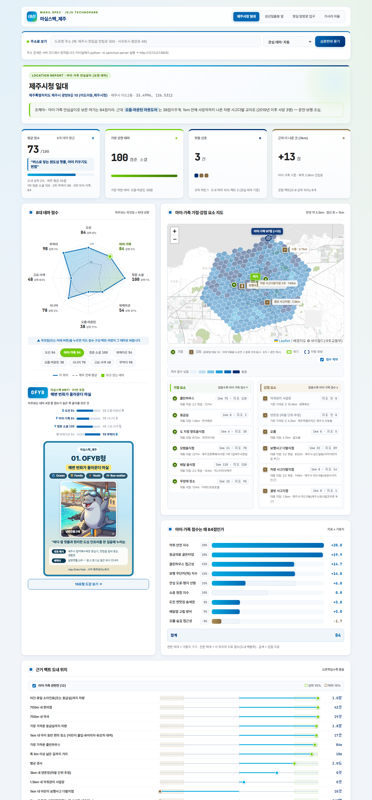
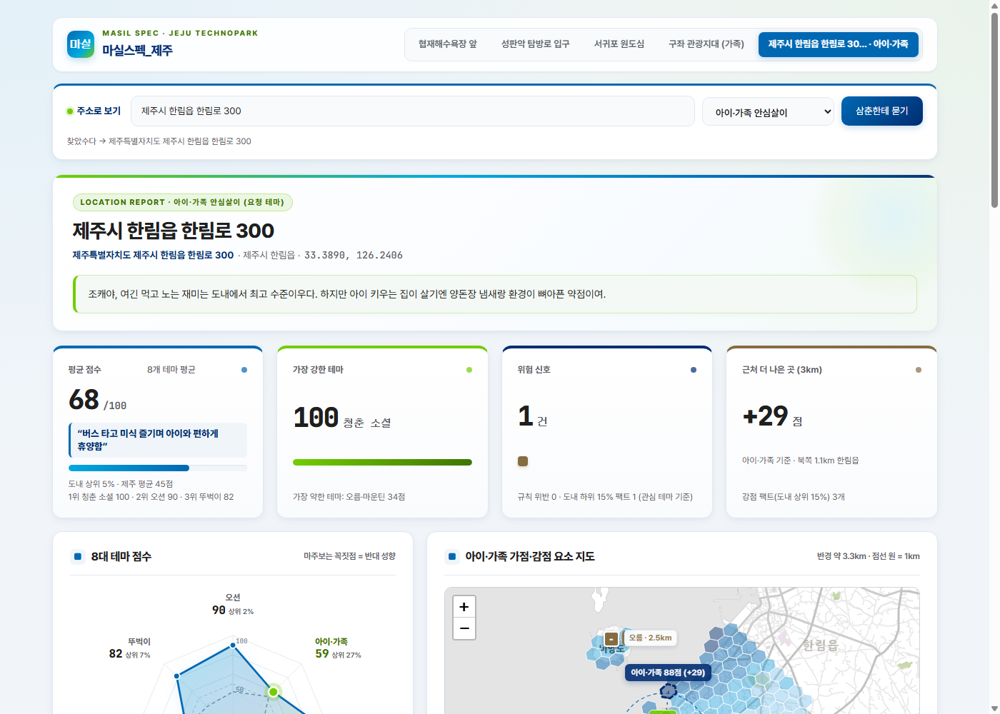
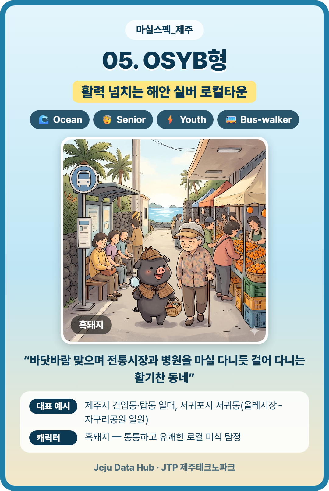

# 마실스펙_제주

> '마실 나간다'의 **마실(동네 생활권)** 을 기준으로 동네의 진짜 스펙을 나누는 앱의 제주 버전.
> 주소 하나를 넣으면 그 동네를 **8대 테마 점수 · 가점/감점 지도 · 근거 팩트 · 현실 처방 · 마실스펙 MBTI 카드**로 보여 주고,
> 브리핑 캐릭터 **'제주 삼춘'** 이 데이터만 가지고 직설적으로 설명한다.

- 제작: JEJU TECHNOPARK (JTP) · 데이터: 제주데이터허브 + 공공 API
- 원 명세: [`docs/ai_agent.md`](docs/ai_agent.md) (JEJU-SAMCHUN-v1.0)
- 파이썬 패키지 이름은 `samchun` (브리핑 페르소나에서 따옴)

| 대시보드 | 삼춘 브리핑 (LLM) | MBTI 카드 |
|---|---|---|
|  |  |  |

---

## 1. 빠른 시작

### 1-1. 설치
```powershell
cd "G:\내 드라이브\project1_data\Jeju_project"
python -m pip install -e ".[dev]"      # Python 3.11+ (geopandas, h3, scipy, pillow 등)
copy .env.example .env                 # 메모장으로 열어 키 입력 — 키는 채팅·문서에 붙이지 않는다
```

### 1-2. 대시보드 보기 (서버 없이)
`app/dashboard/example.html` 을 더블클릭 → 크롬에서 열림. 예시 4곳 탭 — 유형·테마·지역이 모두 다르게 골랐다:

| 예시 | 관심 테마 | MBTI | 성격 |
|---|---|---|---|
| 제주시청 일대 | 아이·가족 | OFYB | 북쪽 도심 |
| 성산일출봉 앞 | 오션 | OFYW | 동쪽 해안 관광지 |
| 영실 탐방로 입구 | 마운틴 | MSQB | 한라산 고지대 (매표소, 해발 1,021m) |
| 가시리 마을 | 고요·사색 | MFQW | 남동 중산간 마을 |

예시는 `src/samchun/dashboard.py` 의 `EXAMPLES` 에서 바꾼다.
배경지도가 이미지로 들어 있어 서버·인터넷 없이도 지도가 보인다.

### 1-3. 주소 검색 (로컬 서버)
```powershell
python -m samchun.server            # http://127.0.0.1:8800
python -m samchun.server --llm      # 삼춘 브리핑·한줄평을 LLM 으로
```
- 검색하면 점수·지도·기본 문장이 **1~2초** 안에 먼저 뜨고, `--llm` 이면 '✍ 삼춘이 말 다듬는 중…' 표시 뒤
  20~30초 후 그 자리(총평·한줄평·브리핑 원문)만 AI 문장으로 바뀐다 (`/api/view` → `/api/brief`).
- 도로명·지번·건물명('제주시청')·마을 이름('애월읍 하귀1리' → 마을 중심 추정)·'위도,경도' 모두 가능.
- 파이썬 코드를 고치면 서버를 재시작해야 한다 (template.html 은 요청마다 다시 읽음).

### 1-4. LLM (삼춘 브리핑) 설치 — 선택
```powershell
winget install Ollama.Ollama           # 설치 후 PowerShell 새로 열기 (PATH 반영)
ollama pull gemma4:12b-it-qat          # 7.2GB, RTX 3060 12GB 에서 전부 GPU, 초당 약 33토큰
python -m samchun.agent "33.3938,126.2392" --theme social   # 첫 줄 '생성: llm' 이면 성공
```
LLM 이 없으면 같은 근거로 **템플릿 브리핑**이 자동으로 나온다 (점수·팩트는 동일, 문장만 다름).

### 1-5. 원격에서 결과 확인 (서버 화면을 못 볼 때)
```powershell
python scripts/screenshot.py app/dashboard/example.html docs/screenshots/now.png --size 1400x3000
python scripts/compare_llm.py          # 예시 4곳 LLM vs 템플릿 + 근거 밖 숫자 검사 → docs/llm_vs_template.md
```

---

## 2. 폴더 구조

```
Jeju_project/
├─ README.md
├─ pyproject.toml            패키지·의존성
├─ .env / .env.example       API 키 (.env 는 공유 금지)
├─ config/
│  ├─ themes.yaml            8대 테마 · 12대 지표 · 가중치 매트릭스 (+ 수정 이력 주석)
│  ├─ datasets.yaml          데이터셋 레지스트리 (허브·외부 출처 ↔ 지표)
│  ├─ masil_mbti_16.md       마실스펙 MBTI 16유형 도감 (이름·정의·특징·대표 지역·캐릭터)
│  └─ masil_mbti_art.yaml    유형별 제주 캐릭터 소재·콘셉트·일러스트 프롬프트
├─ src/samchun/              파이썬 패키지 (아래 3장)
├─ app/
│  ├─ dashboard/
│  │  ├─ template.html       대시보드 단일 템플릿 (JTP 팔레트, Leaflet)
│  │  ├─ example.html        예시 4곳 정적 대시보드 (생성물)
│  │  ├─ example_llm.html    같은 것, 삼춘 브리핑 LLM 판 (생성물)
│  │  └─ mbti/cards/         MBTI 카드 PNG 16장 + 모음 시트 (생성물)
│  └─ streamlit_app.py       초기 Streamlit 판 (참고용, 지금은 대시보드가 기본)
├─ scripts/
│  ├─ screenshot.py          HTML → PNG (헤드리스 크롬)
│  ├─ compare_llm.py         LLM 브리핑 회귀 확인
│  └─ fetch_hub_catalog.py   제주데이터허브 전체 목록 재수집 → data/reference/
├─ tests/                    pytest (11개)
├─ docs/
│  ├─ ai_agent.md            원 명세서
│  ├─ llm_vs_template.md     최근 LLM 브리핑 비교 결과
│  ├─ screenshots/           화면 캡처
│  └─ reference/             외부 가이드 PDF (빅데이터센터 반출 기준, 비짓제주, 도로명주소 API) — git 제외, 로컬만
└─ data/                     (git 제외, 용량 약 8GB)
   ├─ raw/<데이터셋>/        원천 그대로 · jeju_cardimage/NN.png = MBTI 일러스트 원본
   ├─ interim/               정제 캐시 (지오코딩, 지형, POI, 도로폭, 배경지도 타일 등)
   ├─ processed/             grid · raw · facts · indicators · scores (.parquet) + backup/
   └─ reference/             jejudatahub_list_all.xlsx (허브 카탈로그)
```

---

## 3. 동작 구조

```
수집 (collect/*)  →  지표 (features)  →  점수 (scoring)  →  근거·처방 (agent)  →  화면 (dashboard / server)
  허브·공공API        H3 셀별 12지표       8대 테마 가중합      팩트·규칙·LLM 브리핑     view JSON → template.html
```

| 모듈 | 하는 일 | 실행 |
|---|---|---|
| `collect.catalog` · `collect.hub` | 허브 카탈로그 대조, 받아야 할 원천 목록 | `python -m samchun.collect.catalog` |
| `collect.external` · `visitjeju` · `tourapi` | 공공 API 수집 (버스, 사고다발, 상가, 도로중심선 등) | `python -m samchun.collect.external` |
| `rentcar` · `terrain` · `travellog` · `pois` | 렌터카 집계, 고도·경사, 여행로그, 지도 지점 캐시 | `python -m samchun.<모듈>` |
| `spatial` | 좌표계(EPSG:5179/4326), **H3 res9** 그리드 (육상 23,439셀) | — |
| `features` | 12대 지표 원시값 + 실측 팩트 (`facts.parquet`) | — |
| `scoring` | 지표(0~100) × 가중치 → 8대 테마 점수 | — |
| `pipeline` | 위 전체 실행 → `data/processed/` | `python -m samchun.pipeline` |
| `agent` | 주소→셀, 강점·경고·규칙, 처방(반경 3km 더 나은 곳), 관점 차이, 삼춘 브리핑 | `python -m samchun.agent "주소"` |
| `geocode` | 브이월드 주소↔좌표 (+ 도로명주소 API 보조), 마을 중심 추정 | — |
| `mbti` | 4축 비교 → 16유형 코드, 카드 PNG 내보내기 | `python -m samchun.mbti --export` |
| `dashboard` · `server` · `tiles` | view JSON → HTML, 로컬 서버, 브이월드 타일 중계/내장 | `python -m samchun.dashboard` |

---

## 4. 8대 테마 · 12대 지표

테마 점수 = Σ(지표 점수 0~100 × 가중치%). 마주보는 4쌍(극성 쌍)이 팔각형의 반대 꼭짓점에 놓인다:
**오션↔마운틴 · 가족↔시니어 · 소셜↔고요 · 워케이션↔뚜벅이**.

| 지표 | 가족 | 오션 | 소셜 | 뚜벅이 | 워케이션 | 고요 | 시니어 | 마운틴 |
|---|---:|---:|---:|---:|---:|---:|---:|---:|
| i01 악취 안전 | 20 | 5 | 0 | 5 | 5 | 25 | 10 | 5 |
| i02 클린하우스 접근성 | 15 | 5 | 0 | 20 | 5 | 0 | 5 | 0 |
| i03 소음 청정 | 10 | 0 | −10 | 5 | 25 | 30 | 10 | 30 |
| i04 응급의료 골든타임 | 20 | 5 | 0 | 5 | 0 | 0 | 25 | 10 |
| i05 도민 찐맛집 | 5 | 10 | 25 | 15 | 10 | 5 | 5 | 0 |
| i06 대리 프리 음주권 | 0 | 15 | 35 | 5 | 0 | 0 | 0 | 0 |
| i07 배달앱 고립 방어 | 5 | 5 | 15 | 5 | 20 | 0 | 0 | 0 |
| i08 보행 무단차 | 15 | 10 | 0 | 15 | 0 | 5 | 15 | 0 |
| i09 대중교통 배차망 | 0 | 5 | 15 | 30 | 0 | 0 | 10 | 5 |
| i10 청정 해변·레저 | 0 | 35 | 10 | 0 | 0 | 0 | 0 | 0 |
| i11 오름·숲길 접근성 | −5 | −5 | −5 | −5 | 5 | 10 | 0 | 45 |
| i12 안심 도로·평지 | 15 | 10 | 15 | 0 | 30 | 25 | 20 | 5 |

- **i12 안심 도로** = 사고(보행·결빙·차량 사상자) : 경사 : 고도(겨울 안개·결빙) : **외길**(폭 6m 이상 도로까지 거리) = 1 : 1 : 1 : 0.5
- 가중치 수정 이력과 근거는 `config/themes.yaml` 머리 주석에 있다 (시니어·마운틴 열 정정, 마운틴 '도시 감점' 제거, 가족 열 안심도로 반영).

### 검증 (AI Hub 2023 여행로그 1,650건 · 방문 22,079건)
여행객 세그먼트가 방문한 셀의 자기 테마 점수가 평균보다 높은가 (`python -m samchun.travellog`):

| 세그먼트 | 테마 | 차이 | 8개 중 순위 |
|---|---|---:|---:|
| 밤문화 | 청춘 소셜 | +4.7 | 1 |
| 등산 | 마운틴 | +1.1 | 2 |
| 웰니스 | 고요·사색 | +0.2 | 2 |
| 해양 스포츠 | 오션 | +1.1 | 2 |
| 시니어 | 시니어 | −0.7 | 4 |
| 아이 동반 | 가족 | −2.5 | 5 |

아이 동반 **여행객**은 오름·관광지를 가므로(오름 지표 +5.3) 가족 테마('아이와 **살기**')의 기준이 되지 못한다.
그래서 가족 테마는 **아이 생활 시설**(상가정보: 교과·태권도·음악·미술·외국어 학원, 소아과, 장난감·유아의류, 반경 1km)과의
상관으로 따로 검증한다: **+0.34 → +0.46** (2026-11 가족 열 수정 후). 여행과 생활의 차이는 대시보드·브리핑의 **'관점 차이'** 로 보여 준다.

---

## 5. 대시보드 구성

1. **상단** 주소 검색 (서버 모드) · 예시 탭
2. **위치 리포트** 도로명주소·행정동·좌표 + 삼춘 총평 한 줄
3. **KPI 4칸** 평균 점수(+ 한줄평) · 가장 강한 테마 · 위험 신호 · 근처 더 나은 곳(3km)
4. **8대 테마 팔각형** (꼭짓점/버튼 클릭 → 지도·점수 구성·팩트·처방이 그 테마로 전환) + **마실스펙 MBTI** (4축 막대 + 카드, 16유형 도감)
5. **가점·감점 요소 지도** 점수 격자(기본 ON) + 종류별 대표 지점 1곳, 범례 클릭 → 그 종류 전체 표시
6. **점수는 왜 ○점인가** 지표 × 가중치 기여도
7. **근거 팩트 도내 위치** 상위/하위 15% 강조
8. **팩트 경고 · 현실 처방전 · 관점 차이**
9. 접힘: 삼춘 브리핑 원문 · 데이터 한계 · 기술 정보(H3 셀, 요청 번호, 브리핑 생성 방식)

디자인: JTP 클린테크 팔레트, 그래프 우선, 정적 HTML 단독 동작.

---

## 6. 마실스펙 MBTI

4쌍의 점수 비교로 4글자 코드 → 16유형 (`config/masil_mbti_16.md`).

| 글자 | 비교 |
|---|---|
| **O** / **M** | 오션 ≥ 마운틴 |
| **F** / **S** | 가족 ≥ 시니어 |
| **Y** / **Q** | 청춘 소셜 ≥ 고요·사색 |
| **W** / **B** | 워케이션 ≥ 뚜벅이 |

- 캐릭터는 **제주 고유 소재** 16종 (남방큰돌고래, 제주의 바람, 뿔소라·보말, 현무암 먹돌, 흑돼지, 주상절리, 동백꽃, 은빛 억새, 오름, 갈옷, 조랑말, 곶자왈, 한라산 노루, 설문대할망, 돌담·밭담, 한라산 백록) — `config/masil_mbti_art.yaml`
- 일러스트 교체: `data/raw/jeju_cardimage/NN.png` (정사각형) 덮어쓰기 →
  `python -m samchun.mbti --export` (카드 PNG 1080×1611, `app/dashboard/mbti/cards/`) → `python -m samchun.dashboard`
- 일러스트가 없는 유형은 같은 틀에 그림 프롬프트를 적은 스케치 카드로 표시된다.

---

## 7. 제주 삼춘 브리핑 (LLM)

- 코드가 근거(점수표·강점·경고·규칙·처방·관점 차이)를 고르고, LLM 은 **문장만** 다듬는다 — 근거에 없는 숫자·지명 금지.
- 모델: Ollama `gemma4:12b-it-qat` (OpenAI 호환 `/v1/chat/completions`). `.env` 의 `LLM_BASE_URL`·`LLM_MODEL` 로 교체 가능.
- Gemma 4 의 '생각 모드'는 로컬에서 끈다 (`reasoning_effort: none`, 24초 → 4초/문장).
- 출력 정리 (`agent.py`):
  - `clean_brief` 첫 소제목 앞 인사말 제거, `## 제목 — 설명` 형태 정리
  - `fix_dialect` 12B 모델이 자주 틀리는 제주어 어미 교정 (`하수다→하주게`, `됩수다→되우다`, `크수다→크우다` …) — 규칙 추가는 `DIALECT_FIX`
  - 데이터 한계 문장은 코드가 표준어로 붙인다
- 제주어 말투 규칙·예문은 `SYSTEM_PROMPT` 의 [제주어 말투 규칙] 블록.
- 한줄평 (`llm_oneliner`): 상위 3테마 + 동네 강점 → 30자 이내 생활 장면. 실패하면 화면 기본 문장.
- 프롬프트를 고친 뒤엔 `python scripts/compare_llm.py` 로 근거 밖 숫자가 없는지 확인.

---

## 8. 데이터 출처 · API 키

| `.env` 키 | 출처 | 쓰는 곳 |
|---|---|---|
| `JEJUHUB_API_KEY` | 제주데이터허브 | 클린하우스·악취·소음·렌터카 등 원천 |
| `DATA_GO_KR_KEY` | 공공데이터포털 | TAGO 버스, 사고다발(도로교통공단·표준데이터), 상가정보, 관광공사 TourAPI, 향토·모범음식점 등 |
| `VisitJeju_API_KEY` | 비짓제주 | 음식점·관광지 태그(무장애·아이) |
| `KMA_APIHUB_KEY` | 기상청 API허브 | 여름 바람(악취 노출) |
| `Vworld_API_KEY` | 브이월드 | 주소↔좌표, 배경지도 타일 |
| `Vworld2Ddata_API_KEY` | 브이월드 2D 데이터 | 수치지도 도로중심선 `LT_L_N3A0020000` (도로폭·차로수) |
| `JUSO_API_KEY` | 행안부 도로명주소 검색 | 주소 검색 보조 (좌표·도로폭은 주지 않음) |

키 없이 쓰는 출처: OpenStreetMap 도로, AWS Terrain Tiles(고도·경사), 행정동 경계(vuski/admdongkor), AI Hub 여행로그(수동 다운로드).
전체 목록과 지표 연결은 `config/datasets.yaml`.

**보안**: 브이월드 키는 서버 안에서만 쓰고 HTML 로 내보내지 않는다 (타일은 서버 중계 또는 이미지 내장). `.env` 는 공유하지 않는다.

---

## 9. 데이터 한계

- 렌터카 지표는 2020~21년(코로나 시기) 약 3,400대 표본, 여행로그는 2023년 여행객 약 1,650건 표본
- 양돈장 위치는 지번이 가려져 마을 중심으로 추정 (오차 1km 안팎)
- 주행 시간은 신호·정체·배편을 뺀 자유주행 추정
- 국토교통부 교통약자·기상상태 사고다발 API 는 인증은 되나 제주 데이터 0건 (2026-11 기준) → 도로교통공단 자료로 대체
- 도로폭은 수치지도 도로중심선 기준 — 농로가 많아 '좁은 길 비율'보다 '넓은 길까지 거리'를 지표로 사용

---

## 10. 다음 할 일

- [x] 검색 대기 단축: 점수·지도 먼저 표시(1~2초), 삼춘 브리핑은 생성되면 채우기
- [x] 가족 테마 가중치 재점검 (아이 생활 시설 상관 +0.34 → +0.46)
- [ ] 가족 테마에 아이 생활 시설(학원·소아과·놀이터)을 직접 넣는 13번째 지표 검토
- [ ] 서울판: 지역 설정 분리(`config/regions/<지역>`) 후 자치구 2~3곳 시범
- [ ] 배포 방식 결정 (내부 시연용 정적 페이지 vs 서버)

---

## 11. 개발

```powershell
python -m pytest -q                 # 테스트 11개
python -m samchun.pipeline          # 지표·점수 다시 계산 (가중치·지표 수정 후)
python -m samchun.travellog         # 여행로그 검증
python -m samchun.dashboard         # 예시 대시보드 다시 만들기
```
점수를 크게 바꾸기 전에는 `data/processed/scores.parquet` 를 `data/processed/backup/` 에 복사해 두고, 여행로그 검증 전후를 비교한다.
